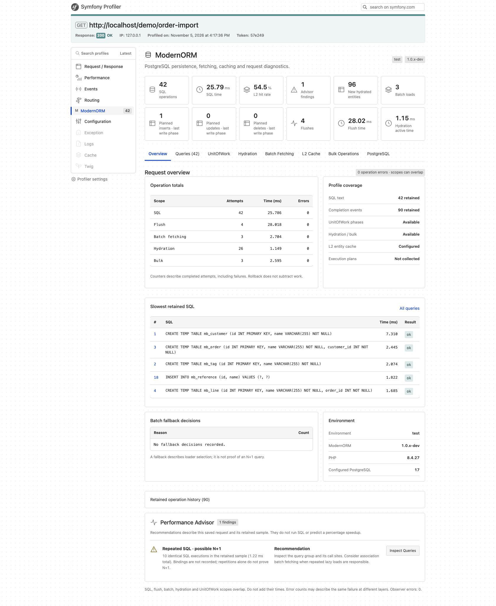

# ModernORM

**PostgreSQL power. Fewer lazy-load queries. Built-in ORM statistics.**

ModernORM is a PostgreSQL-first ORM for PHP 8.4+, designed for ERP systems and applications with large object graphs, reference data, and demanding database workloads.

Write domain logic with entities. Load related objects in batches. Use PostgreSQL SQL directly when a query needs it. Measure SQL, flush and batch activity through one statistics API.

## Why ModernORM

- **Reduce N+1 queries without adding fetch joins to every query.** Lazy many-to-one references are grouped and loaded together when accessed.
- **Use the database you chose.** PostgreSQL is the only target. SQL expressions, CTEs, and `RETURNING` fit directly into the query API.
- **See the cost of persistence.** Built-in SQL/flush/batch counters, timings, actual batch sizes, cache efficiency and fallback reasons explain persistence work on the same connection.
- **Keep a focused entity model.** PHP attributes, one scalar entity ID, and native lazy objects form the supported contract.
- **Keep entities and SQL in one workflow.** Managed objects share an Identity Map and UnitOfWork; queries can also return rows without hydrating entities.

**Implemented today:** lazy ManyToOne, OneToMany, and ManyToMany batching, SQL-first entity queries, native lazy objects, the initial Statistics API, entity-by-ID L2 caching through `#[Cacheable]`, and PostgreSQL bulk writes with BYPASS/CLEAR policies. **Next:** restricted bulk SYNC and additional statistics/Observability adapters.

## Symfony Debug Toolbar & Profiler

See what your persistence layer does in each request with [ModernORMBundle](https://github.com/andreybolonin/modernormbundle#profiler-gallery): SQL activity, association batches, entity L2 cache, hydration, UnitOfWork phases and PostgreSQL bulk writes. The Performance Advisor links evidence-based recommendations to the relevant query or panel.



Captured from the local implementation using a PostgreSQL demonstration workload, including bulk writes and deliberate repeated lookups. These figures illustrate the interface, not benchmark performance. Extended metrics require the core operation-event API; older core versions show unavailable metrics explicitly. EXPLAIN plans and buffer statistics are not collected.

See the [bundle's profiler gallery](https://github.com/andreybolonin/modernormbundle#profiler-gallery) for batch fetching, L2 cache, bulk operations and the dark theme.

## ModernORM vs. Doctrine ORM

| Capability | ModernORM | Doctrine ORM 3.7.x |
| --- | --- | --- |
| Database strategy | **PostgreSQL-first, PostgreSQL-only** | Multiple databases through DBAL |
| Queries | **SQL QueryBuilder with entity hydration** | DQL QueryBuilder and native SQL |
| Related-object loading | **Batch lazy ManyToOne, OneToMany, and ManyToMany on access** | Fetch joins and eager to-one batching through fetch-mode configuration |
| Statistics | **SQL/flush/batch counts, durations, errors, group sizes, cache efficiency and fallback reasons**, with optional neutral completion events | DBAL SQL instrumentation and L2-specific cache statistics |
| L2 Cache | **Entity-by-ID caching through `#[Cacheable(ttl: ...)]`**, PSR-6 storage and generation-based invalidation; no public regions or strategy configuration | Entity, collection, and query cache regions with access strategies; documented as experimental |
| Mapping | **Attributes, scalar entity IDs, concrete entities and MappedSuperclass** | Multiple drivers, entity inheritance, composite and association IDs |
| Lazy objects | **PHP 8.4 native lazy objects throughout** | Native lazy objects and proxy configuration options |

ModernORM chooses a narrower set of scenarios so fetching, persistence, and observability can evolve around PostgreSQL workloads. Comparative latency and memory benchmarks are still ahead; the query reduction below is already covered by integration tests.

## Fewer queries, the same objects

Configure batching on the association:

```php
use Doctrine\Common\Collections\Collection;
use ModernORM\Mapping as ORM;

class Order
{
    #[ORM\ManyToOne(targetEntity: Customer::class, batchSize: 32)]
    public Customer $customer;

    #[ORM\OneToMany(mappedBy: 'order', targetEntity: OrderItem::class, batchSize: 32)]
    #[ORM\OrderBy(['position' => 'ASC'])]
    public Collection $items;

    #[ORM\ManyToMany(targetEntity: Tag::class, batchSize: 32)]
    public Collection $tags;
}
```

Or set a shared default before creating the EntityManager:

```php
$config->setLazyFetchBatchSize(32); // Used when the association omits batchSize.

$orders = $em->getRepository(Order::class)->findBy([], ['id' => 'ASC']);
foreach ($orders as $order) {
    echo $order->customer->name;
}
```

Accessing one queued customer reference loads a batch of compatible references with an `IN` query. Your application continues working with the same PHP objects.

**Verified: 7 different references, batch size 3, just 3 additional SELECTs instead of 7.** Repeated foreign keys share one object; already loaded entities and local changes are preserved. Loaded entities participate in normal change tracking and flush.

Batching is opt-in. Association `batchSize` overrides Configuration; omitting it inherits the global default of 1. Use `batchSize: 1` to disable batching for a relation. EAGER loading keeps its own strategy. The implementation covers lazy ManyToOne, OneToMany, and ManyToMany with scalar IDs. One-to-one associations and partial entity references keep their existing loading paths. Cached ManyToOne targets combine L2 hits with one SQL IN query for misses; an all-hit batch performs no SELECT. Uncached targets still batch with L2 enabled; cached ManyToMany targets retain their ordinary collection SQL loader. Streaming only batches references that have already been discovered.

For OneToMany, reading one collection loads rows for queued owners through an FK `IN` query. Empty collections are initialized too; OrderBy, indexBy, Identity Map, and pending additions are preserved. **Seven owner collections at size 3 use three SELECTs**, including empty owners. Queues are separated by association role and batch size. EXTRA_LAZY partial operations keep their existing behavior. [Collection batching contract](docs/collection-batch-fetching.md).

ManyToMany batches work on **both owning and inverse sides**, including shared targets and self-referencing associations. Each join-table membership is preserved while related entities share one Identity Map object. Pending add/remove operations retain ordinary owning-side write rules. [ManyToMany batching contract](docs/many-to-many-batch-fetching.md).

Only references with the same target class and effective batch size share a batch. If different relations reach the same Identity Map object, the smallest observed size wins; an explicit size of 1 excludes that object from batching.

The queue belongs to one EntityManager and follows clear/detach/close. PostLoad runs for peers when their batch loads. [Batch fetching details](docs/batch-fetching.md).

## Local benchmark results

**100 orders, 100 distinct lazy targets: 101 SELECTs become 5 with a batch size of 32.** Both runs return the same data and retain the same 200 managed entities.

Measured on **PHP 8.4.27, PostgreSQL 17.11 (Homebrew), macOS**, with a local database connection. SQL counts include the initial owner query; wall time includes fetching and hydration. Memory values are PHP heap deltas during loading, not process RSS.

| Batch size | SELECTs | Wall time | Retained heap | Peak heap delta |
| --- | --- | --- | --- | --- |
| 1 | 101 | 11.679 ms | 482.0 KiB | 667.0 KiB |
| 32 | 5 | 3.035 ms | 296.9 KiB | 639.9 KiB |

This is one run per batch size, in the order 1 then 32. Warm-up and allocation effects differ between runs. The query reduction is verified; timing and memory values are observations, not a production performance guarantee or a comparison with Doctrine.

### Statistics overhead

A separate `SELECT 1` microbenchmark runs **200 queries per round, 7 rounds per mode**, including result fetching. Each connection is warmed up, and measurement order rotates between modes.

| Statistics mode | Median total time / 200 queries | Observed round range |
| --- | --- | --- |
| Disabled | 6.260 ms | 5.590–11.199 ms |
| Counters enabled | 6.335 ms | 5.299–6.577 ms |
| Counters + empty observer | 6.334 ms | 5.217–6.744 ms |

The observed differences overlap run-to-run variation. These measurements do not establish a fixed overhead percentage for application workloads. The empty observer measures event delivery without an exporter; it does not represent Prometheus or OpenTelemetry export costs.

### Bulk writes

Measured on **PHP 8.4.27, DBAL 4.5.0, PostgreSQL 17.11 (Homebrew), macOS arm64**, using a local connection and a 1 GiB PHP memory limit. Three measured rounds per case after warm-up; the table shows median milliseconds. L2 is disabled and Statistics counters are enabled.

| Rows | Operation | UnitOfWork | Bulk BYPASS | Bulk CLEAR |
| --- | --- | --- | --- | --- |
| 1,000 | INSERT | 52.00 ms | 6.18 ms | 6.13 ms |
| 1,000 | UPDATE | 68.41 ms | 2.00 ms | 1.99 ms |
| 1,000 | DELETE | 57.78 ms | 0.44 ms | 0.73 ms |
| 10,000 | INSERT | 493.19 ms | 59.66 ms | 64.71 ms |
| 10,000 | UPDATE | 687.82 ms | 15.75 ms | 16.57 ms |
| 10,000 | DELETE | 560.56 ms | 2.05 ms | 2.23 ms |
| 100,000 | INSERT | 5,316.99 ms | 1,057.47 ms | 1,250.96 ms |
| 100,000 | UPDATE | 7,199.46 ms | 282.42 ms | 330.56 ms |
| 100,000 | DELETE | 5,586.01 ms | 29.59 ms | 53.41 ms |

Each sample commits one transaction. UnitOfWork persists/removes entities and flushes once; UPDATE/DELETE include target loading. Bulk INSERT explicitly uses 1,000-row chunks; UPDATE/DELETE use one statement. SQL counts at 100,000 rows are **100,002 / 100,003 / 100,003** for UnitOfWork INSERT/UPDATE/DELETE (including flush savepoints), versus **100 / 1 / 1** for either bulk policy.

All cases start with 1,000 unrelated managed entities; UPDATE/DELETE also preload 1,000 affected entities. BYPASS retains that context and stale objects; CLEAR detaches it. Setup and correctness checks are outside timing. At 100,000 inserted rows, the median additional peak PHP heap was **227.4 MiB with UnitOfWork and 1.34 MiB with either bulk policy**. These are heap deltas after preloading, not total process memory.

Bulk skips entity hydration, dirty checking and per-row callbacks; these workflows have different semantics. BYPASS/CLEAR timing differences include run-to-run variation and do not isolate the cost of clearing. No production throughput or Doctrine comparison is implied. [Methodology and options](benchmarks/README.md) · [All samples, throughput and memory](benchmarks/results/bulk-2026-11-05.json).

### Entity L2: local Redis measurements

Measured on PHP 8.4.27, PostgreSQL 17.11 and Redis 8.10.3 on macOS, with local connections. Each case loads **100 distinct targets**, using a fresh EntityManager; five measured rounds follow a warm-up. Mixed mode primes the first 50 IDs. Medians include cache access and hydration; setup/cache priming are excluded.

| Workflow | L2 disabled | Cold L2 | Warm L2 | 50% warm L2 |
| --- | --- | --- | --- | --- |
| 100 find-by-ID calls | 13.68 ms | 33.74 ms | 10.74 ms | 25.01 ms |
| 100 lazy ManyToOne targets, batch size 32 | 3.47 ms | 25.67 ms | 11.12 ms | 19.45 ms |

SQL counts in the same order are **100 / 100 / 0 / 50** for find-by-ID and **5 / 5 / 1 / 4** for ManyToOne (including the owner SELECT). Warm reads record 100 L2 hits; mixed reads record 50 hits and 50 misses.

Updating 100 already-managed entities and committing took **16.04 ms without L2** and **31.73 ms with INVALIDATE**, which records 200 pre/post-commit eviction events. Both execute 100 UPDATE statements. The timed interval excludes loading, initial cache priming and post-update refill; correctness checks verify fresh cold and warm reads afterwards.

**Fewer SQL statements do not guarantee lower latency.** Here, batched PostgreSQL reads outperform even warm Redis L2; cache round trips and hydration still cost time. Cold/mixed cache paths and write invalidation add overhead. These small local rows and local services do not represent expensive queries, networked databases or production throughput. [Methodology](benchmarks/README.md) · [All samples and counters](benchmarks/results/l2-2026-11-05.json).

Reproduce against a dedicated test database:

```sh
PGUSER=your_role PGDATABASE=modernorm_test php benchmarks/batching.php
PGUSER=your_role PGDATABASE=modernorm_test php benchmarks/statistics.php
PGUSER=your_role PGDATABASE=modernorm_test php -d memory_limit=1G benchmarks/bulk.php > bulk-results.json
PGUSER=your_role PGDATABASE=modernorm_test MODERNORM_BENCH_REDIS_DSN=redis://127.0.0.1:6379 php benchmarks/l2.php > l2-results.json
```

The scripts emit JSON with environment and measurement details. Adjust `MODERNORM_BENCH_ROWS`, `MODERNORM_BENCH_ITERATIONS` and `MODERNORM_BENCH_ROUNDS` as needed. Bulk options and measurement boundaries are documented in [benchmarks](benchmarks/README.md). [Verification report](docs/beta-verification.md).

## Query PostgreSQL. Get entities or rows.

Keep PostgreSQL expressions in your queries and get managed entities back:

```php
$query = $em->createQueryBuilder()->fromEntity(Project::class, 'p');

$projects = $query
    ->where($query->column('p', 'name') . ' = :name')
    ->setParameter('name', 'alpha')
    ->orderBy('p.id')
    ->setMaxResults(20)
    ->getQuery()
    ->getResult();

// Read rows without creating managed entities.
$rows = $em->createQueryBuilder()
    ->select('id', 'name')
    ->from('projects')
    ->executeQuery()
    ->fetchAllAssociative();
```

`fromEntity()` builds a complete entity projection and its result mapping. `column(alias, field)` resolves a mapped property to its SQL column. Association joins and their hydration mappings are explicit; DQL association paths are not parsed.

PostgreSQL expressions and CTEs are available through SQL. The dedicated [bulk API](docs/bulk-api.md) supports multi-row INSERT, UPSERT through `ON CONFLICT`, UPDATE, DELETE, and raw `RETURNING` rows:

```php
use ModernORM\Bulk\BulkPolicy;

$result = $em->bulk()->upsert(Product::class, [
    ['sku' => 'A', 'price' => '12.50'],
    ['sku' => 'B', 'price' => '15.00'],
], conflictFields: ['sku'], updateFields: ['price'],
   policy: BulkPolicy::CLEAR, returning: ['id', 'sku']);
```

Choose `BYPASS` to preserve UnitOfWork state, or `CLEAR` to detach the entire context and discard pending work after success. Neither mode flushes automatically or invokes per-row ORM callbacks; version guards and increments are explicit. Declared READ_ONLY L2 regions are invalidated before DML and after commit in both modes. Cached writes require an API-owned transaction; uncached writes can participate in a caller-owned transaction. Trigger/cascade dependencies must be declared. COPY and restricted SYNC remain future work; direct DBAL SQL does not automatically use this bulk invalidation protocol.

For pagination over collection fetches, use the explicit root-ID SQL Paginator. Row limits and streaming over a collection fetch mapping are rejected to avoid presenting incomplete collections as fully loaded.

[SQL Query API](docs/sql-query-api.md) · [Migration example](examples/migration/README.md)

## Read reference data without tracking field changes

Use a dedicated marker for entities whose existing rows should stay unchanged during flush:

```php
#[ORM\Entity]
#[ORM\Immutable]
class Currency
{
    // Map identifiers, fields, and associations as usual.
}
```

ModernORM skips entity field/FK updates while allowing INSERT and DELETE. Associated mutable entities, cascades, and collection links keep their normal persistence rules. SchemaTool still creates and manages the table. Native lazy loading, batch fetching, and the Identity Map retain the read-only policy.

This is a change-tracking policy; it is independent of PHP `readonly` and READ_ONLY L2 caching. [Read-only entity contract](docs/immutable-entities.md).

## Know what your ORM costs

Count queries, measure SQL/flush/batch time, and see actual batch sizes, cache efficiency and fallback reasons without requiring a profiler or an external metrics backend.

Install the statistics middleware **before** creating the DBAL connection:

```php
use Doctrine\DBAL\Configuration as DBALConfiguration;
use Doctrine\DBAL\DriverManager;
use ModernORM\Statistics;
use ModernORM\Statistics\Middleware;

$statistics = new Statistics(enabled: true);
$dbalConfig = new DBALConfiguration();
$dbalConfig->setMiddlewares([new Middleware($statistics)]);
$connection = DriverManager::getConnection($connectionParams, $dbalConfig);

// Create the EntityManager with this connection and your ORM configuration.
// After executing application work:
$snapshot = $statistics->snapshot();

$snapshot->sqlCount;
$snapshot->sqlTimeMilliseconds();
$snapshot->sqlErrors;
$snapshot->flushCount;
$snapshot->flushTimeMilliseconds();
$snapshot->flushErrors;
$snapshot->batch->count;
$snapshot->batch->selectedReferences;
$snapshot->batch->selectedCollections;
$snapshot->batch->cacheHits;
$snapshot->batch->cacheMisses;
$snapshot->batch->fallbackCounts;
```

The collector is scoped to **one DBAL Connection**. Direct SQL and all EntityManagers sharing that connection contribute to its totals. `EntityManager::getStatistics()` returns the collector, or null if no middleware was installed.

Collection is disabled by default. Snapshots are immutable; reset and enable/disable are supported, including discarding old in-flight measurements at worker boundaries. SQL text, parameter values and entity references are not stored. Counts include failed attempts; rollback does not subtract completed work. SQL timing excludes result fetching and hydration; batch timing includes hydration/PostLoad. SQL, flush and batch durations overlap and must not be added together.

Pass an optional `OperationObserver` to `new Statistics(enabled: true, observer: $observer)` to consume immutable SQL/flush/batch/bulk/hydration and UnitOfWork phase completion events and fallback decisions. Events include timestamps, durations, outcomes and batch sizes; core retains no history. Observer failures are isolated and counted. This is the foundation for separate Symfony Profiler, Prometheus and OpenTelemetry adapters; exporters, active trace spans and Grafana dashboards are not bundled. A separate [OpenTelemetry prototype in ModernORMBundle](https://github.com/andreybolonin/modernormbundle/tree/main/examples/observability) demonstrates OTLP metrics, Collector accumulation, VictoriaMetrics and a provisioned Grafana dashboard without adding monitoring dependencies to the core.

[Statistics API contract](docs/statistics.md) · [Batch statistics](docs/batch-statistics.md) · [Bulk, hydration and UnitOfWork events](docs/operation-events.md)

## Cache reference data with an explicit lifecycle

Cache flat reference entities across EntityManagers with `#[ORM\Cacheable(ttl: 3600)]` and an explicit PSR-6 pool. The entity-by-ID path includes cold/warm reads, native lazy references, typed values and application namespace isolation. Configuration and invalidation need no public regions or factories:

```php
$config->setSecondLevelCache($pool, namespace: 'my_app_l2_v1');

// After constructing EntityManager:
$em->getCache()->evict(Currency::class, 'USD');
$em->getCache()->evictAll(Currency::class);
```

Entries contain database scalar rows, so local object changes and callbacks stay local. Generation-based eviction prevents an in-flight fill from restoring an invalidated value. READ_ONLY is the default write policy and rejects ORM UPDATE. Opt in to updates with `writePolicy: CacheWritePolicy::INVALIDATE`:

```php
use ModernORM\Cache\CacheWritePolicy;
use ModernORM\Mapping as ORM;

#[ORM\Entity, ORM\Cacheable(ttl: 3600, writePolicy: CacheWritePolicy::INVALIDATE)]
class Currency
{
    #[ORM\Id, ORM\Column(length: 3)] public string $code;
    #[ORM\Column] public string $name;
}
```

INVALIDATE delegates UPDATE and optimistic version checks to the normal ORM persister, evicts before the write and after commit, and fills fresh raw values on a later read. INSERT/DELETE use the same invalidation boundary. `#[ORM\Immutable]` is independent: with it, field changes are ignored under either cache policy. Known post-commit cache failure and uncertain COMMIT are explicit errors, never automatic SQL retries.

**Current scope:** cached entities have no declared associations. Reads inside transactions use SQL; cached writes require an ORM-owned top-level flush or the dedicated bulk API's owned transaction. L2 query-result/collection caches and legacy locking/RW strategies have been removed; INVALIDATE uses generation-based eviction. Metadata/query-plan caching remains available. Cached ManyToOne combines L2 hits and batched misses; transaction reads bypass L2 for the whole batch. Cached ManyToMany batching remains future work. ArrayAdapter, FilesystemAdapter and standalone RedisAdapter have focused coverage; standalone Redis outage/restart recovery is checked, while automatic failover and general network partitions remain uncertified. Optional class-level counters track hits, misses, puts and evictions. [Configuration and migration](docs/read-only-l2-cache.md) · [L2 scenario matrix](docs/l2-scope-matrix.md).

Metadata and entity result-plan caches already use PSR-6. The plan cache stores entity projections, not DQL compilation results. When mappings change, update both cache namespaces and create new EntityManagers/builders. Result caching and L2 are separate mechanisms.

## Less machinery to configure and support

ModernORM removes entire scenarios to keep the supported contract focused. MappedSuperclass, embeddables, composite UNIQUE constraints, and many-to-many join-table keys remain available.

| Removed capability | ModernORM approach |
| --- | --- |
| L2 query-result/collection caches, RW strategies and public cache regions/factories | Entity-only `Cacheable` with PSR-6 storage and generation-based invalidation |
| Other database platforms | PostgreSQL-only runtime |
| DQL parser, lexer, AST, walkers, custom DQL functions, and run-dql CLI | DBAL SQL QueryBuilder or SQL with explicit ResultSetMapping |
| DQL-based paginators | Explicit root-ID SQL pagination |
| SINGLE_TABLE/JOINED inheritance and discriminator hydration | Concrete entities, composition, and MappedSuperclass for shared mappings |
| Composite entity IDs and association-as-ID | One scalar PK per entity; composite UNIQUE constraints and join-table PKs remain supported |
| XML/SimplifiedXml/database mapping drivers and mixed driver chains | Attributes-only mapping; YAML/docblock annotations are unsupported |
| Criteria SQL translation and repository matching | Explicit QueryBuilder conditions; array-based repository criteria for equality, IN, and NULL |
| ORM Filters | Explicit application predicates and access scope; no automatic tenant isolation |
| Generated proxy classes and legacy lazy-object switches | Native lazy objects on PHP 8.4+ |

`PersistentCollection::matching()` explicitly rejects Criteria matching without initializing the collection; the method signature remains because of its parent collection contract.

[Mapping scope and migration](docs/mapping-scope.md)

## A complete persistence workflow

Build around CRUD, an Identity Map and UnitOfWork, snapshot or explicit change tracking, four basic association types, cascades, orphan removal, EXTRA_LAZY operations, embeddables, MappedSuperclass, lifecycle callbacks/listeners, and basic locking/transaction contracts. The [compatibility matrix](docs/compatibility.md) records the verified scenarios.

Migrating from Doctrine ORM requires adapting queries and unsupported mappings. All ModernORM exception classes and marker interfaces now live in `ModernORM\Exception` under `src/Exception`; update existing imports and catch clauses accordingly. The Composer package is `andreybolonin/modernorm`, with namespace `ModernORM\`. Change mapping imports to `use ModernORM\Mapping as ORM`; Doctrine mapping attribute aliases are not provided. Symfony integration lives in the separate ModernORMBundle package. Coexistence with DoctrineBundle has been exercised in a local Symfony application; domain migration remains explicit.

## Documentation

Start with the [documentation index](docs/README.md) for architecture, API contracts and release information.

## Beta status

ModernORM 0.1 is a beta line with a bounded PostgreSQL/PHP contract; it is not a production-stable 1.0 release. The intended scope, compatibility rules, tested cache backends and pending publication gates are in the [beta contract](docs/beta-release.md). See [CONTRIBUTING](CONTRIBUTING.md), [SECURITY](SECURITY.md) and [CHANGELOG](CHANGELOG.md).

ModernORM is maintained independently through community issues and PRs. There is no automatic or scheduled porting of Doctrine fixes.

## Install the beta

Use an explicit beta stability flag when installing the published Composer package:

```sh
composer require 'andreybolonin/modernorm:^0.1@beta'
```

Map a small entity using `ModernORM\Mapping` attributes, then create the manager:

```php
use Doctrine\DBAL\DriverManager;
use ModernORM\Configuration;
use ModernORM\EntityManager;
use ModernORM\Mapping\Driver\AttributeDriver;

$connection = DriverManager::getConnection([
    'driver' => 'pdo_pgsql',
    'host' => getenv('PGHOST') ?: '127.0.0.1',
    'dbname' => getenv('PGDATABASE') ?: 'modernorm_test',
    'user' => getenv('PGUSER') ?: 'postgres',
    'password' => getenv('PGPASSWORD') ?: 'postgres',
]);
$config = new Configuration();
$config->setMetadataDriverImpl(new AttributeDriver([__DIR__.'/src/Entity']));
$em = new EntityManager($connection, $config);
```

For complete executable entity/repository code, use the [persistence example](examples/migration/README.md). In a disposable database, SchemaTool can create the mapped tables; application deployments should use reviewed migrations through the separate ModernORMBundle integration. The [release consumer check](docs/beta-release.md#repeatable-local-release-checks) verifies the packaged CRUD/batching/cache workflow without a local source dependency.

## Get started locally

Requirements: PHP **8.4+**, PostgreSQL, and `pdo_pgsql`; Composer supplies DBAL 4.3+, Doctrine Collections **3.1+ (3.x)**, and the remaining dependencies. Symfony cache adapters and Console tooling are optional integrations.

Collections 2 is not supported. `PersistentCollection::add()` returns `void`; call it as a statement rather than checking a boolean result.

```sh
composer install
PGUSER=your_role PGDATABASE=modernorm_test vendor/bin/phpunit
composer validate --strict
```

Tests read `PGHOST`, `PGPORT`, `PGUSER`, `PGPASSWORD`, and `PGDATABASE`. Defaults are `127.0.0.1:5432`, `postgres`/`postgres`, and `modernorm_test`. Use a dedicated test database: tests create and drop `modernorm_test_*` tables.

The latest local verification passed **418 tests / 2170 assertions** on PHP **8.4.27 and 8.5.12**, PostgreSQL **17.11**. The detailed scope and limitations are recorded in the [compatibility matrix](docs/compatibility.md).

Next: restricted bulk SYNC and additional statistics/Observability adapters. See the [roadmap](roadmap.md) and [architecture](docs/architecture.md).

## License

[MIT](LICENSE). Third-party license texts are preserved in [licenses/](licenses/).
